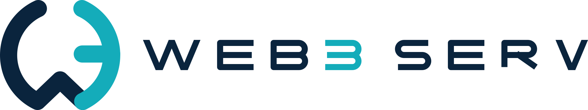

<picture>
  <source media="(prefers-color-scheme: dark)" srcset="./w3s-logo-ondark.svg">
  
</picture>

### Institutional Web3 services platform

**Soon** · [web3serv.com](https://web3serv.com)

---

## Services

### Engineering & build

- **Contract, wallet and platform build** Spec to production: smart contracts, wallet and signing integrations, and complete platform interfaces.
- **Smart-contract development & audit prep** Solidity 0.8.x with OpenZeppelin v5 standards and exhaustive test coverage ahead of any external audit.
- **Web3 integrations** Wallets, SIWE, on-chain verification and live contract reads inside your existing product, with ongoing support.
- **Ongoing platform engineering** A continuous engineering team for your platform: features, maintenance, performance, monitoring.

### Security & audit

- **Smart contract security audit** Adversarial contract review: ownership powers, known risk patterns, economic invariants and reentrancy analysis.
- **Verification, Audit Review & Trust Mark** Web3 Serv reviews projects against defined, documented criteria and publishes the outcome — so the market can judge readiness on evidence, not hype. Review is not endorsement.
- **Listing Readiness Reports** A Listing Readiness Report is an independent, structured assessment of how prepared your project is to be reviewed by centralized or decentralized exchanges — so you fix gaps before you approach anyone. It measures readiness only.

### Legal & compliance

- **Legal and technical advisory** Project structure, documentation and technical drafting, coordinated with licensed counsel in the relevant jurisdiction.
- **Regulatory licensing file support** Licence files prepared and coordinated with the competent authority in each jurisdiction. The decision rests with the regulator.
- **Compliance-aware launch advisory** Utility framing, disclosure policy, jurisdiction gates, and a responsible launch roadmap.

### Platforms & community

- **Full hiring platform** Verified professional profiles, job listings, application review and moderated reviews.
- **Community Boost campaigns** Verified quest campaigns for trusted projects: Telegram and Discord joins, each checked against a grant the member gave us, with sybil resistance.
- **Academy & Knowledge Center** Learn to build Web3 the right way.
- **Launchpad** The Web3 Serv launchpad will come later — after verification, Trust Mark, launchpad readiness, and the supporting systems are in place. It is built for projects that have already been reviewed, not for anyone who shows up.

### Payments

- **Digital payment cards** A payment-card programme designed to run with a licensed issuer and BIN sponsor — issuance stays with the licensed institution.

---

The full site is under construction · <a href="https://web3serv.com">web3serv.com</a>

